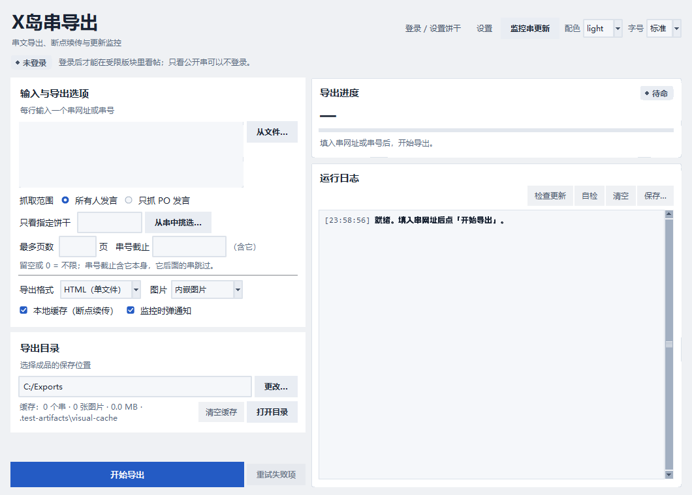

# Xdao Thread Exporter

[简体中文](README.md) · **English**

**Keep complete X island threads on disk for offline reading.** Log in to read beyond the guest limit of 100 pages, then export to HTML, PDF, EPUB, Markdown or TXT. Embed images, resume interrupted downloads, and follow new replies.

[](https://github.com/XiaoFeng7418/xdao-export/actions/workflows/tests.yml)
[](https://github.com/XiaoFeng7418/xdao-export/releases/latest)
[](LICENSE)

[**Download for Windows**](https://github.com/XiaoFeng7418/xdao-export/releases/latest) · [User guide (Chinese)](docs/USAGE.md) · [Documentation](docs/README.md) · [Report an issue](https://github.com/XiaoFeng7418/xdao-export/issues)



Actual v0.23.0 interface, shown with demo settings; [dark mode](docs/screenshot-dark.png).

## What it does

| Need | Feature |
| --- | --- |
| Offline archives | Five formats, reply numbers, author IDs and original-poster markers; HTML can embed images into a single file |
| Easy setup | Unzip and run on Windows, without installing Python; browser login without copying cookies from developer tools |
| Recovery | Page and image caches, incremental updates, retrying failed exports, and skipping existing files |
| Following a thread | Scheduled checks, automatic exports and desktop notifications; import/export watch lists |
| Focused exports | Original-poster or author filtering, page limits, filename templates, batches and merged exports |

PDF requires a local Chromium browser such as Edge or Chrome. If the browser cannot run, the tool saves HTML and explains the fallback. Merged exports support HTML, PDF, Markdown and TXT; EPUB exports remain separate. See [format and image options (Chinese)](docs/USAGE.md#格式与图片模式).

## Download and export

The latest release, **v0.23.0**, provides these files:

| File | Purpose |
| --- | --- |
| `xdao-export-v0.23.0-win64.zip` | Portable Windows 64-bit build; unzip and run `xdao-export.exe` |
| `xdao-export-v0.23.0-win64.zip.sha256` | SHA256 checksum for that zip |

1. Download both files from the [official Releases page](https://github.com/XiaoFeng7418/xdao-export/releases/latest).
2. Verify the checksum and extract the zip to a writable folder. Keep `xdao-export.exe` beside its `_internal` folder.
3. Open the app, choose “登录 / 设置饼干” → “用浏览器登录”, and log in with an X island account. Pasting a cookie is also supported.
4. Paste a thread URL or ID, select a format and destination, then click “开始导出”. Guest exports work too, but only cover the first 100 pages.

If Windows shows a SmartScreen warning, first confirm the official download source and verify the SHA256 checksum. Only if both check out, choose “More info” → “Run anyway”; otherwise cancel.

Browser login supports Chromium-based browsers such as Edge and Chrome; Firefox is not supported. Login uses a separate, app-managed browser profile and does not read your everyday browsing profile. It normally starts with a temporary profile, but may reuse an existing app window or fall back to a persistent profile that retains site login data. Complete any CAPTCHA yourself. If no compatible browser is available, use cookie paste or account/password login.

### Verify the download

Put the zip and checksum file in the same folder, then run in PowerShell:

```powershell
Get-FileHash .\xdao-export-v0.23.0-win64.zip -Algorithm SHA256
Get-Content .\xdao-export-v0.23.0-win64.zip.sha256
```

The SHA256 values should match. This verifies the downloaded bytes against the published checksum; it does not replace checking the download source or protect against both release assets being replaced together.

### Code signing policy

**Current releases are unsigned.** The publisher is XiaoFeng7418 ([@XiaoFeng7418](https://github.com/XiaoFeng7418)). Windows may show “Unknown publisher” or a SmartScreen warning. Verify the source and checksum before deciding whether to run the program.

The SignPath Foundation application was declined on 2026-10-02. A signing workflow exists but is not enabled, and no active signing service is claimed. If enabled in the future, builds will come from GitHub Actions, require manual approval, and sign only this project's executable. XiaoFeng7418 currently handles maintenance, review and approval. See [signing status and workflow (Chinese)](docs/SIGNING.md).

## Run from source

Requires **Python 3.10+**, plus tkinter for the GUI (normally included in the official Windows Python installer). The application uses only Python's standard library; no third-party Python runtime packages are required.

```powershell
python main.py
```

The command line supports batches and long-running watches. Examples use the official test thread `50000001`:

```powershell
python main.py 50000001 -f html -o exports
python main.py 50000001 --scope po -f markdown -o exports
python main.py 50000001 --watch --interval 600 -f html
python main.py --selftest --offline
python main.py --help
```

For the portable build, replace `python main.py` with `xdao-export.exe`. The [user guide (Chinese)](docs/USAGE.md) covers all flags, image folders, PDF settings, watch-list backups and troubleshooting. The desktop interface is currently in Chinese.

## Privacy and responsible use

- Login cookies are stored **unencrypted** in a local configuration file. Plaintext account passwords are not saved. Do not share the configuration folder or include cookies, account details or private thread content in an issue.
- No telemetry, advertising or crash reporting. Cookies are sent only to the site; network activity serves login, thread/image retrieval, GitHub update checks and upgrades explicitly started in the app. Export processing stays local. See the [privacy policy](docs/PRIVACY.md).
- `--offline` selects local self-checks; it is not a global network-blocking option.
- Defaults use a 0.08-second request interval, up to two retries, and the server's `Retry-After` response. Watches check every five minutes by default. Keep a reasonable request rate; do not bypass limits or scrape at scale.
- Follow the [site rules](https://www.nmbxd.com/t/50000001), [official guide](https://www.nmbxd.com/t/50577215) and [site disclaimer](https://www.nmbxd.com/t/11689471). Export only content that is available to your account and that you may lawfully save for personal reading or backup.

## Documentation and development

| Resource | Contents |
| --- | --- |
| [User guide (Chinese)](docs/USAGE.md) | Login, export formats, all CLI flags, configuration, caches and common problems |
| [Documentation index](docs/README.md) | Release notes, privacy, signing, audits and engineering tools |
| [Latest release notes (Chinese)](docs/RELEASE_NOTES_v0.23.0.md) | v0.23.0 changes and assets |
| [Maintenance](MAINTENANCE.md) / [Handoff](HANDOFF.md) | Architecture, project rules, tests and maintenance workflows (Chinese) |

`main.py` is the GUI/CLI entry point; `xdao/` contains the application, `docs/` the documentation, `tools/` the maintenance utilities, and `tests/` the offline suite. Tests use fake services and isolated configuration, with artifacts kept in `.test-artifacts/`.

```powershell
python -m pytest -q -rs
python -m ruff check .
```

pytest and Ruff are development tools only. Read the maintenance notes before changing CLI, configuration or exported-document behavior. Headless environments skip Tk tests and do not validate the GUI.

## License and copyright

**MIT License** · Copyright (c) 2026 XiaoFeng7418 ([@XiaoFeng7418](https://github.com/XiaoFeng7418)). Use, modify and redistribute the software, including commercially, while retaining the copyright and license notices. See [`LICENSE`](LICENSE), shipped as `LICENSE.txt` in the portable build.

Bundled Python, Tcl/Tk and PyInstaller components remain subject to their upstream licenses; this project's MIT license does not replace them. Third-party license coverage in the current package still needs improvement; see the [dependency audit (Chinese)](docs/backlog/04-dependency-boundary.md). Exported content belongs to X island and its original authors. Thanks to Python, Tcl/Tk, PyInstaller, Rcrwrate/Xdnmb_downer and the DeepSeek agent that contributed implementation and tests.

## Disclaimer

This is an independent, **unofficial** project, with no affiliation, partnership, sponsorship or authorization from X island or its operators. The software is provided **“as is”**, without warranties of availability, accuracy or fitness for a particular purpose. To the extent permitted by applicable law, the author is not liable for losses caused by using or being unable to use it.

Respect the rights and privacy of content owners. Do not use the tool for harassment, tracking or unlawful activity. Submit rights concerns and bug reports through [repository issues](https://github.com/XiaoFeng7418/xdao-export/issues), after removing credentials and private content.
