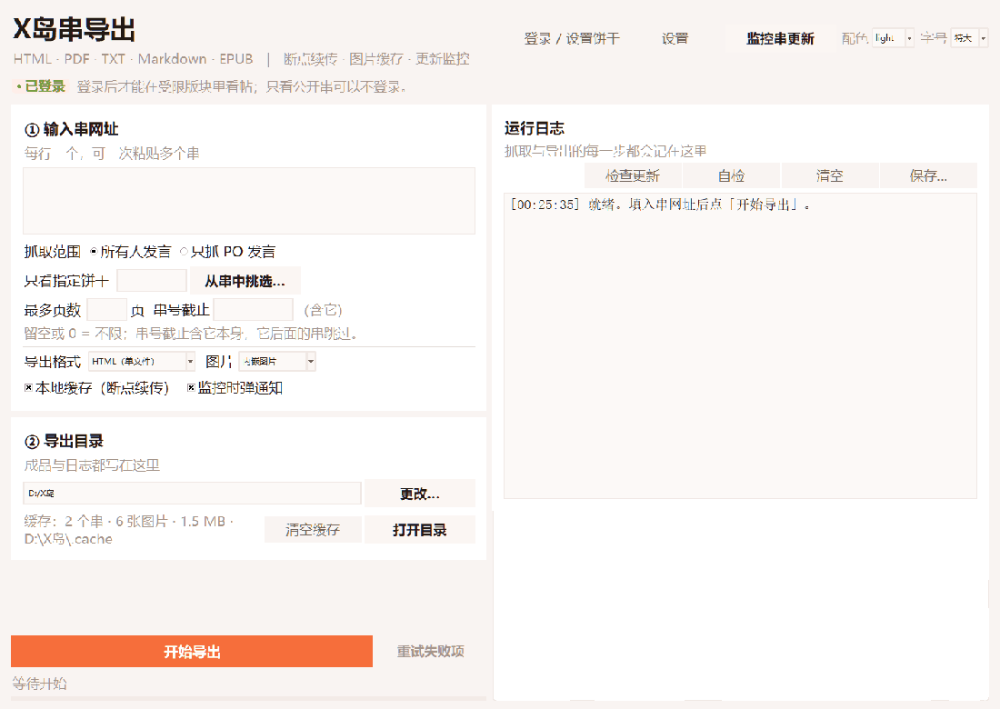

# X岛串导出工具

> 本项目已停止后续功能开发与日常维护，当前 `v0.24.2` 按现状公开归档保留。

**简体中文** · [English](README.en.md)

**把 X 岛（nmbxd1.com）的长串完整存到本地，随时离线阅读，也支持 B 岛（bog.ac）公开串，无需 B 岛登录。** X 岛登录后可读取游客 100 页限制以外的内容；支持 HTML、PDF、EPUB、Markdown、TXT，图片可内嵌，抓取中断后可续传。

[](https://github.com/XiaoFeng7418/xdao-export/actions/workflows/tests.yml)
[](https://github.com/XiaoFeng7418/xdao-export/releases/latest)
[](LICENSE)

[**下载 Windows 免安装包**](https://github.com/XiaoFeng7418/xdao-export/releases/latest) · [使用指南](docs/USAGE.md) · [文档导航](docs/README.md) · [反馈问题](https://github.com/XiaoFeng7418/xdao-export/issues)



v0.24.0 的真实界面，使用演示配置截图；[查看深色模式](docs/screenshot-dark.png)。

## 项目用途

| 需要 | 工具提供 |
| --- | --- |
| 长串离线存档 | 五种格式，保留楼层、发言饼干与 PO 标记；HTML 可内嵌图片成为单文件 |
| 开箱即用 | Windows zip 解压双击，无需安装 Python；浏览器登录无需手抄 Cookie |
| 中断后继续 | 页面与图片缓存、增量更新、失败项重跑，已有成品可跳过 |
| 跟进连载 | 定时检查新回复、自动导出和桌面通知，监控列表可导入/导出 |
| 按需整理 | 仅 PO / 指定饼干筛选、限页、文件名模板、批量与合并导出 |

PDF 需要本机 Edge / Chrome 等 Chromium 浏览器；浏览器不可用时会改存 HTML 并提示原因。合并导出支持 HTML / PDF / Markdown / TXT，EPUB 按串独立保存。详见[格式与图片模式](docs/USAGE.md#格式与图片模式)。

## 下载与第一次导出

最新版 **v0.24.2** 提供免安装包：

| 附件 | 用途 |
| --- | --- |
| `xdao-export-v0.24.2-win64.zip` | Windows 64 位免安装包，解压后双击 `xdao-export.exe` |
| `xdao-export-v0.24.2-win64.zip.sha256` | 与 zip 配套的 SHA256 校验文件 |

1. 从[官方 Releases 页面](https://github.com/XiaoFeng7418/xdao-export/releases/latest)下载 zip 和同名 `.sha256`。
2. 核对摘要后解压到可写目录；`xdao-export.exe` 与 `_internal` 文件夹必须放在一起。
3. 导出 X 岛长串时，在「登录 / 设置饼干」中选择「用浏览器登录」，用 X 岛账号登录一次；也可直接粘贴 Cookie。B 岛公开串无需登录。
4. 粘贴 X 岛（nmbxd1.com）或 B 岛（bog.ac）的公开串网址，选择格式与保存目录，点击「开始导出」。纯串号默认走 X 岛；X 岛未登录时只能读取前 100 页。

如 Windows 显示 SmartScreen「已保护你的电脑」，先确认来自官方发布页并核对 SHA256；确认无误后可点「更多信息」→「仍要运行」，否则取消。

登录使用由本程序管理的独立浏览器资料目录，不读取日常浏览器的资料目录；通常新建临时窗口，也可能复用本程序已有窗口或备用资料目录并保留站点登录状态。验证码仍需自行完成。浏览器登录仅支持 Edge / Chrome / Chromium / Brave 等 Chromium 浏览器（**Firefox 不行**）。找不到兼容浏览器时，可使用粘贴 Cookie 或账号密码登录。

### 核对下载文件

把两个附件放在同一文件夹，在 PowerShell 中运行：

```powershell
Get-FileHash .\xdao-export-v0.24.2-win64.zip -Algorithm SHA256
Get-Content .\xdao-export-v0.24.2-win64.zip.sha256
```

比较两处的 SHA256 摘要。相同表示文件与发布页上的校验值一致；它不能替代对下载来源的确认，也不能防止 zip 与校验文件同时被替换。

### 代码签名状态（Code signing policy）
当前发布包未进行代码签名，Windows 可能显示「未知发布者」或 SmartScreen 警告。请从官方 Releases 页面下载，并使用同名 `.sha256` 文件校验完整性。GitHub Actions + SignPath 相关配置仅作历史归档保留，流程尚未启用，当前无启用计划。详见[签名状态与发布完整性](docs/SIGNING.md)。
## 从源码运行

需要 **Python 3.10+**。界面还需要 tkinter（Windows 官方 Python 安装包通常自带）；运行时仅使用 Python 标准库，无需安装第三方 Python 包。

```powershell
python main.py
```

命令行可用于批量导出和长期监控；纯数字或 X 岛网址默认走 X 岛，B 岛公开串可用 `https://bog.ac/t/7001234`；示例使用官方测试串 `50000001`：

```powershell
python main.py 50000001 -f html -o exports
python main.py 50000001 --scope po -f markdown -o exports
python main.py 50000001 --watch --interval 600 -f html
python main.py https://bog.ac/t/7001234 --site auto -f html -o exports
python main.py --selftest --offline
python main.py --help
```

免安装版可将 `python main.py` 换成 `xdao-export.exe`。完整参数、图片目录模式、PDF 设置、监控备份与排错都在[使用指南](docs/USAGE.md)。

## 隐私与使用边界

- 登录饼干保存在本机配置文件中，**未加密**；不保存明文账号密码。不要共享配置目录，也不要把 Cookie、账号或私人串内容贴进 issue。
- 无遥测、广告或崩溃上报。Cookie 仅发送至站内；联网用于站点登录、读取内容和图片，以及 GitHub 版本检查与主动升级下载。导出处理在本机完成。[隐私说明](docs/PRIVACY.md)。
- `--offline` 用于离线自检，不是全局阻止联网的开关。
- 默认请求间隔 0.08 秒、失败最多重试 2 次并遵从服务端 `Retry-After`；监控默认每 5 分钟检查一次。请保持合理频率，勿批量滥抓或绕过限流。
- 请遵守[岛规](https://www.nmbxd.com/t/50000001)、[官方使用指南](https://www.nmbxd.com/t/50577215)与[官方免责声明](https://www.nmbxd.com/t/11689471)，仅导出有权查看的内容，用于合法的个人阅读与备份。

## 文档与开发

| 入口 | 内容 |
| --- | --- |
| [使用指南](docs/USAGE.md) | 登录、导出格式、全部 CLI 参数、配置与缓存、常见问题 |
| [文档导航](docs/README.md) | 发布说明、隐私与签名、审计报告、工程工具 |
| [最新发布说明](docs/RELEASE_NOTES_v0.24.2.md) | v0.24.2 的发布内容与附件 |
| [维护规范](MAINTENANCE.md) / [项目技术说明](HANDOFF.md) | 架构、硬性约定、测试清单与维护流程 |

```text
main.py       图形界面与命令行入口
xdao/         网络、缓存、监控、导出器与 Tkinter 界面
docs/         使用指南、发布说明与审计资产
tools/        构建、截图、仓库检查与维护工具
tests/        3048 个离线单元测试（3040 通过，另 8 项默认跳过）
```

用例总数由 `pytest --collect-only` 收集，并由文档事实守卫核验；真机、权限及打包产物用例仅在满足各自明确条件时跳过。无显示环境需显式声明无头模式，额外跳过 Tk 用例，不能视作已验证界面。开发检查（pytest / Ruff 仅为开发工具）：

```powershell
python -m pytest -q -rs
python -m ruff check .
```

测试使用假接口与隔离配置，无需真实账号；产物留在 `.test-artifacts/`。修改前请先读维护规范，保持 CLI、配置与导出格式兼容。

## 开源协议与版权

**MIT License** · Copyright (c) 2026 XiaoFeng7418。允许免费使用、修改和分发，包括商业用途，须保留版权与许可声明。全文见 [`LICENSE`](LICENSE)，免安装包内为 `LICENSE.txt`。

打包版包含 Python（PSF）、Tcl/Tk（BSD 风格）、PyInstaller（GPL 与 bootloader exception）和 OpenSSL（Apache-2.0），本项目的 MIT 许可不替代它们的上游许可。`THIRD_PARTY_LICENSES/` 原样保留构建环境的 `Python-LICENSE.txt`、`PyInstaller-COPYING.txt`，以及精确匹配版本的官方 `OpenSSL-LICENSE.txt` 与版权说明 `OpenSSL-README.md`；原有 Tcl/Tk 许可继续随包保留。索引 `README.txt` 记录实际版本、来源和 SHA256；未备有对应 OpenSSL 原文的构建会明确标注 `MISSING`，请在分发前核对该索引。数据与内容归 X 岛、B 岛平台及原作者所有。感谢 Python、Tcl/Tk、PyInstaller、Rcrwrate/Xdnmb_downer 及所有贡献者。

## 免责声明

本工具为独立开发的**非官方**项目，与 X 岛及其运营方不存在隶属、合作、赞助或授权关系。软件按「现状」提供，不作可用性、准确性或特定用途的担保；在适用法律允许的范围内，不对使用或无法使用软件所产生的损失承担责任。

导出内容的版权与隐私权属于各自权利人；请勿侵犯他人权利，勿用于骚扰、跟踪或违法活动。权利主张与问题反馈可通过[仓库 issue](https://github.com/XiaoFeng7418/xdao-export/issues)提交，请先移除凭据及私人内容。
